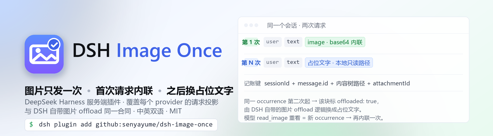
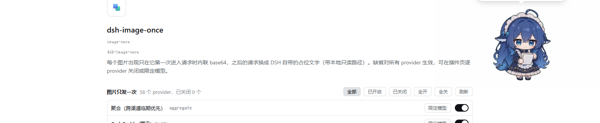

# dsh-image-once

English | [中文](README.md)

<p align="center">
  <picture>
    <source media="(prefers-color-scheme: dark)" srcset="assets/banner-dark.png">
    
  </picture>
</p>

[](LICENSE)

[](https://github.com/senyayume/dsh-image-once/stargazers)

Every image block in a conversation is inlined as base64 **only in the one request where that occurrence
first appears**. Every later request is handed the same block marked `offloaded: true`, which the built-in
DSH image-offload projection turns into its own placeholder text — the text names the attachment and its
read-only local path, so the model can `read_image` it again when it actually wants to look.

The plugin is a server-side (host) plugin. It rewrites the message projection for one request only; it
does not write anything back to the session, and it registers no new route — it wraps the adapters that
are already registered, so request replay and the host's own offload decisions keep working unchanged.

> This page is a summary. The Chinese README ([README.md](README.md)) is the canonical document: it
> carries the measured numbers, the data contracts checked against the shipped bundles, and the reasons
> behind what we do not do. Where the two disagree, the Chinese one wins.

## Screenshots

The plugin's own page, reached from **Settings → Plugins → the `dsh-image-once` row → Configure**:



The row itself, with the switch that enables or disables the whole plugin:


Both are real screenshots of this machine's DSH Desktop (light theme). The providers listed there are
whatever this machine happens to have installed — **the plugin does not know any provider name**; it just
lists the names the host registry hands it.

## Why

`dsh-llm-pi-ai` re-inlines **every not-yet-offloaded image occurrence** as base64 in **every request**.
Paste a few screenshots into one conversation, and every step of that conversation carries a multi-megabyte
request body.

Measured (one gateway, same image), request body versus time to first byte:

| Request body | First byte |
|---|---|
| 49 B (text only) | 2.5 s |
| 350 KB | 4.7 s |
| 1.36 MB | 9–11 s |
| 4.10 MB (12 small images) | 25.7–27.6 s |
| 4.38 MB (one large PNG) | 23.5–26.3 s |

The same body sizes cost 1–3.5 s on other routes. A raw TLS split measured that uploading 4.38 MB takes
only 231 ms while the first byte takes 33.2 s — the time goes into ingest on the gateway side, not into our
uplink.

## What it does

One image "occurrence" is `sessionId + message.id + content-tree path + attachmentId`:

- first time it is seen → inlined as-is (the model gets a full look), and it is only **counted after the
  request produces its first chunk** — a failed or retried request does not count as sent;
- any later request → that occurrence is marked `offloaded: true` and DSH's own logic substitutes the
  placeholder text carrying the read-only local path;
- the model calling `read_image` to look again is a **new occurrence** → inlined once more;
- auxiliary requests that carry a `purpose` (session title, summarization) are neither rewritten nor
  counted;
- the bookkeeping is in memory, affects only that request's copy, and is **never written back to the
  session**; `offloaded` is a shared contract field (DSH's own image-offload flow uses it too).

### Both image shapes are handled

`read_image`'s result has **different shapes in different DSH versions**, and the plugin has to recognise
all of them — otherwise it fails silently: images stay inlined in every request and nothing reports an
error.

| Shape | Origin | Structure |
|---|---|---|
| **flat** | the `app.asar`-shipped `createToolResultMessage` | `{ role: "tool", content: [text, image] }` |
| **nested** | the message construction in the profile's `@deepseek-ai/dsh-llm-pi-ai` | `{ role: "user", content: [{ type: "tool-result", content: [text, image] }] }` |

The plugin's scan and rewrite **recurse into `tool-result`**, matching the depth-first convention of DSH's
own `contentHasImage`. Occurrences are keyed by `sessionId + message.id + path + attachmentId`: top-level
paths are plain numbers (`"3"`), nested paths are dotted (`"3.1"`), so an upgrade cannot make an
already-counted top-level image inline itself again.

Rewriting **rebuilds block by block**: untouched blocks (text after an image, the `tool-result` shell) are
kept exactly as they were.

## Two fixed defects

Both are pinned by cases in `test/host.mjs`, and both were **first verified to fail against the old code**
(the tests were not written to pass against the implementation that already existed):

1. **Dropped blocks** — the old implementation started from `content.slice(0, index)` and pushed only
   image blocks in the loop, so every block **after** the first image silently vanished from the request:

   | Original message | What the old code actually sent |
   |---|---|
   | `[text:A, image, text:B]` | `text:A image(offloaded)` — **`text:B` dropped** |
   | `[image, text:"explanation"]` | `image(offloaded)` — **the whole explanation dropped** |

2. **Missed nesting** — the old implementation only looked at the top level of `message.content`, so
   images inside a `tool-result` were invisible (`read_image` results were re-sent in every request on the
   nested shape).

The criterion is not a comment: the two defects were first reproduced as data using the real shapes from
the running surface, then fixed, then the same cases were taken from red to green.

## Configuration (optional)

**Settings → Plugins → the `dsh-image-once` row → Configure** is a provider list: one switch per row, and
turning a row off keeps that provider out of the plugin entirely. A row can also be narrowed to specific
model ids through its "restrict models" control.

By default the plugin applies to **all providers and all models**; switching rows off only narrows those
providers.

```yaml
# this is the block the UI edits; it can also be written by hand in the same place
- id: image-once
  config:
    providers:
      <adapter registration name>:
        enabled: false                            # that provider stays out of the plugin entirely
        models: [deepseek/deepseek-v4.1-flash]    # only these models; empty array = all models
```

Semantics: **a provider that never appears = active**; an empty `providers` map = active for all
providers. Provider names match the **adapter registration name** (the `已包裹 provider "…"` line in the
host log reports exactly this name, not a display name); `models` matches `options.model`, i.e. the model
id.

Changes take effect **immediately, with no restart** — the config is volatile and the plugin re-reads it on
every request.

### Where hand-written YAML goes, and its limits

Write it in the **profile's patch file** (`~/.dsh/profiles/<name>/cordis.patch.yml`); it **overrides** the
line the package itself ships (the patch layers apply in the order bundle → profile → home → CLI, later
layers overriding earlier ones, and `config` is **replaced as a whole**, not merged):

```yaml
- id: image-once
  config:
    providers:
      <adapter registration name>:
        models:
          - deepseek/deepseek-v4.1-flash
```

> Do **not** write `insert:` here — the package's own `cordis.patch.yml` already inserts the
> `id: image-once` line, and a duplicate id makes the plugin's install-time trial boot roll back.

> A plugin's config arrives as the **second argument** of `apply(ctx, config)` through cordis. Do not
> write `ctx.config`: a plugin that has not injected the `config` service throws
> `cannot get property "config" without inject` when it touches it, and the host records that entry as
> `did not activate`.

> The UI and the YAML are the same stored config with a single source of truth; do not edit both at once.

## The client half

The package declares `dsh.client` (`platform: "web"`) and `exports["./client"]`, so the browser loads
`lib/client.js`, which registers the provider-list card above on the `plugins.row.config` slot under
`key = dsh-image-once#image-once`. That bundle is a **hand-written platform closure factory**
(`window.__ModuleLoader__.load({id, factory})`, requiring only `react`, which comes from the platform
seed) — **there is no build step**.

### Colour contract: only DSH's own tokens

The card's stylesheet contains **no colour literals at all** — every colour goes through the
`--dsw-alias-*` role tokens (plus `--dsw-radius-*`, `--dsw-focus-ring-*`, `--ds-font-family-code`), so the
light and dark themes each hold up and skin overrides propagate.

That rule was forced by a real incident: an earlier stylesheet read `--dsh-text` / `--dsh-border` /
`--dsh-accent` / `--dsh-danger` — **four names DSH has never defined** (zero definitions in the shipped
`app.asar` and in `@deepseek-ai/dsh-client-ui-theme`; a scan of 31,829 files was likewise zero). A `var()`
reference to a nonexistent custom property invalidates the whole declaration, so:

- text colour fell back to the browser default (nearly invisible on the light theme);
- switches and selected states used the plugin's own dark fallbacks (blue `#4c8dff`,
  `rgba(120,170,255,.22)`).

**The criterion was the plugin page screenshot**: all text measured `#e6e6e6` (exactly the fallback
written in the CSS) while the official text on the same page was `#0f1115`; the switch pill measured
exactly `rgb(76,141,255)`, byte-for-byte equal to the `#4c8dff` fallback — not "looks like it", a literal
value landing on screen.

`test/client.mjs` now carries a gate: it extracts the stylesheet the bundle actually injects, checks every
`var()` name against an **explicit allowlist**, and requires zero colour literals. Before adding a token,
confirm it is defined by `@deepseek-ai/dsh-client-ui-theme` (or the shipped `ui-primitives`), then add it to
the allowlist — a wrong name now **fails the test** instead of silently rendering the wrong colour.

## The cost

The model's "visual memory" of an image lasts only the request that inlined it; after that it knows the
image exists (sha256, dimensions, file name, read-only local path) and will call `read_image` itself when
it needs the detail, which inlines it once more. For "paste a screenshot, then discuss it in text" this is
essentially free.

## Installing

As a local package (`dsh.bundle.patch` + `cordis.patch.yml`), install it with
`dsh plugin --profile <profile> add <this package's directory|github:senyayume/dsh-image-once>`; it lands
in `dsh.profile.bundles` and appears on the plugins page, where it can be switched on and off.

`@deepseek-ai/schemastery` must stay in the package's `peerDependencies`: the host half does
`import z from "@deepseek-ai/schemastery"`, and because this package is linked into the profile, the bare
specifier is only intercepted by `routeLinked` in an ancestor directory's `peerDependencies`.

**After changing `lib/index.js`, `lib/client.js`, `cordis.patch.yml` or `package.json`, restart DSH Desktop
completely**: when the host replays the patch layers in-process it reuses Node's ESM module cache, so edits
to `.mjs`/`.js` are not picked up by hot reload; changes to `dsh.client`/`exports` in `package.json`
additionally require client-modules to rescan the roster.

## Tests

```sh
node test/run.mjs
```

Runs both halves: `test/host.mjs` (projection, occurrence keying, both image shapes, the two regressions,
the first-chunk bookkeeping) and `test/client.mjs` (the token allowlist, the no-colour-literal gate, and
zh/en key parity). `test/run.mjs` needs the `@deepseek-ai/schemastery` dev peer; if it is missing it stops
with `missing dev peer at …` rather than reporting a pass.
